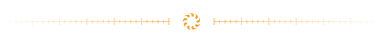

  <picture>
    <source media="(prefers-color-scheme: dark)" srcset="assets/banner-dark.svg">
    <source media="(prefers-color-scheme: light)" srcset="assets/banner-light.svg">
    
  </picture>

  I'm an engineer from Ukraine 🇺🇦, a systems thinker and an analyst by habit. 
  Show me something that works and I want to know why; once I know why, I want to build my own.

  I hold a Master's degree in Applied Sciences (Navigational Engineering). From there it was a gradual dive into the world of algorithms, data, flows and transformations, and now software is most of what I build: the whole stack, because the interesting part is usually where the layers meet.

  <picture>
    <source media="(prefers-color-scheme: dark)" srcset="assets/label-stack-dark.svg">
    <source media="(prefers-color-scheme: light)" srcset="assets/label-stack-light.svg">
    
  </picture>

  
  
  
  
  
   
  
  
  
  
  
  
   
  
  
  
  
  

  <picture>
    <source media="(prefers-color-scheme: dark)" srcset="assets/label-tools-dark.svg">
    <source media="(prefers-color-scheme: light)" srcset="assets/label-tools-light.svg">
    
  </picture>

  
  
  
   
  
  
  

  <picture>
    <source media="(prefers-color-scheme: dark)" srcset="assets/label-about-dark.svg">
    <source media="(prefers-color-scheme: light)" srcset="assets/label-about-light.svg">
    
  </picture>

I know things more in breadth than in depth, and I'm fine with that. The same patterns keep turning up in very different systems, and noticing them is what I enjoy most.

Some of these systems are alive: I build ecosystems, living soil first and now a vermicomposter to feed it. Some are very large: I read about astronomy, biology and the history of life, and my avatar here is the first image of Sagittarius A\*, the black hole at the centre of the Milky Way. And some are games: I enjoy plenty of them, though Factorio, a game about automating everything, turned out to be the one I had been looking for all along.

I see AI in a similar light: a new tool of algorithmisation and automation, this time for all of humanity. I have used language models since the GPT-3 era of ChatGPT, up to Claude Fable 5.2 and Opus 5.5, and I experiment with local machine learning systems. For me they work as an amplifier: they help me see how distant fields connect, and build and learn more than I could alone. I study them the way I would any other tool: how they work, and where they fail.

  It is simply a more interesting way to live. The longer version is on <a href="https://synthropy.space">Synthropy</a>.

  <picture>
    <source media="(prefers-color-scheme: dark)" srcset="assets/divider-dark.svg">
    <source media="(prefers-color-scheme: light)" srcset="assets/divider-light.svg">
    
  </picture>

  Open to roles and offers.

  
  
  

