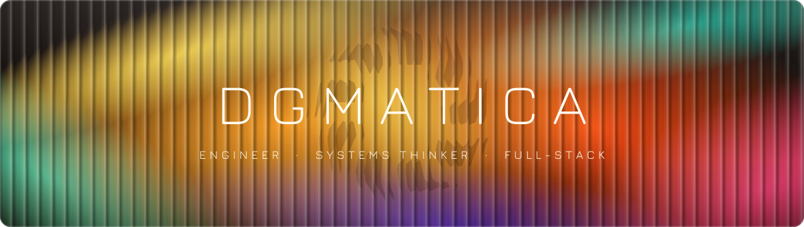

<picture>
  <source media="(prefers-color-scheme: dark)" srcset="assets/banner-dark.svg">
  <source media="(prefers-color-scheme: light)" srcset="assets/banner-light.svg">
  
</picture>

I'm an engineer, a systems thinker and an analyst from Ukraine 🇺🇦. I want to know how a thing works, and then I want to build one myself. I hold a Master's degree in Applied Sciences (Navigational Engineering), and these days what I build is mostly software — the whole stack, because the interesting part is how the layers fit together.

**Stack** 

 

 

**Tools** 

### More about me

I build ecosystems: living soil, and now a vermicomposter to feed it. I read about astronomy, biology and the history of life — my avatar here is the first image of Sagittarius A\*, the black hole at the centre of the Milky Way.

I love games too. At some point I discovered Factorio, and it became my favourite game outright — the one I seem to have been looking for all my life. I enjoy plenty of others as well.

AI runs through most of what I do. I have used language models since the GPT-3 era of ChatGPT, up to Claude Fable 5.2 and Opus 5.5, and I experiment with local machine learning systems. I treat it as an engineer would: a field to study, and output to check and test.

Mostly I like learning something new and then making something with it. Some of that ends up on [Synthropy](https://synthropy.space/en/blog/).

---

Open to roles and offers.

